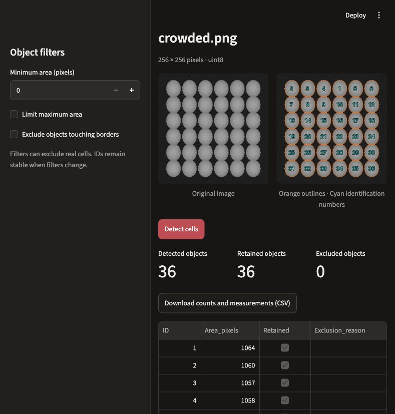

# Automated Microscopy Cell Counter

A local Python and Streamlit application for pretrained Cellpose segmentation, numbered outlines, object counts, pixel areas, filtering, and CSV export.



[Watch the 30-second edited screen-capture demo](demo/microscopy-app-demo.mp4). The public demo uses generated imagery; no Cell Tracking Challenge images are redistributed.

## Quick start

Requires Python 3.11 and enough memory for Cellpose-SAM. The model weights require approximately 1.15 GiB of disk space; inference also uses substantial RAM/GPU memory.

```bash
git clone https://github.com/obey1305/automated-microscopy-cell-counter.git
cd automated-microscopy-cell-counter
python3.11 -m venv .venv
source .venv/bin/activate
python -m pip install -r requirements-lock.txt
python -m streamlit run app.py
```

The repository is private; cloning requires access. Open the local address printed by Streamlit. Upload an image, click **Detect cells**, review the numbered outlines, adjust filters if needed, and download the CSV. First inference downloads pretrained `cpsam_v2` to `.cellpose/models/`. Apple MPS is used when available, otherwise CPU. The application runs locally; no public hosting deployment is included.

## Features

- Upload one microscopy image and run Cellpose 4.2.1.1 without model training.
- Original image beside orange boundaries and cyan instance IDs.
- Detected, retained, and excluded object counts.
- Individual areas measured by counting labeled pixels.
- Inclusive minimum/maximum area filters and optional border exclusion; original IDs retained.
- CSV download containing filename, counts, ID, area, retention status, and exclusion reasons.
- Changing filters reuses predictions; changing images clears old results.

The CSV includes every detected object, including exclusions. Image-level counts repeat on each row: do not sum those columns. Zero detections produce a summary row with blank object fields.

## Supported images

| Input | Support |
|---|---|
| PNG/JPEG | Single grayscale or RGB image; palette, alpha and CMYK converted to RGB |
| 1-bit PNG | Converted to uint8 grayscale |
| TIFF | One 2D image/series; grayscale or RGB, including planar RGB |
| High bit depth TIFF | Original numeric values retained for inference; preview uses linear min–max scaling |
| File size | Up to 32 MiB |
| Dimensions | Up to 4096 × 4096 pixels; smaller images recommended |
| Stacks, Z-volumes, time series | Not supported as uploads; export one frame first |

Non-finite pixels and corrupt files are rejected. Flat images show a warning. uint8 previews use the original 0–255 range; grayscale is repeated into RGB for display. Alpha is discarded, so flatten transparent inputs first when that affects their meaning.

## Evaluation and stress checks

[Evaluation details](EVALUATION.md) document three selected real training images: raw count MAE 1.67 objects/image and mean best annotated-object IoU 0.931. This is exploratory evaluation, not held-out validation or official CTC benchmark scoring. Count references come from tracking markers because segmentation annotations can be partial.

[Stress-test results](ROBUSTNESS.md) cover real clustered/touching crops, a contrast-reduced real frame, and generated crowded/overlapping/low-contrast fields. Equal counts do not imply correct boundaries. Filtering can remove real objects; the app applies no extra area or border exclusions by default. Cellpose inference itself uses a 15-pixel minimum.

## Known limitations

- Nuclear fluorescence images yield nuclear instances and areas, not whole-cell measurements.
- Crowding, overlap, blur, low signal, and unusual microscopy modalities can cause missed, split, or merged objects.
- Pixel areas are not physical areas; there is no microscope calibration input.
- IDs are per-image instance labels, not tracked identities across time.
- Size and border filters are heuristics and require visual review.
- No clinical validation or guarantee of generalization; pretrained training overlap with test data is unknown.
- First use needs internet; large images may exceed available memory. Reduce image dimensions or use a crop if inference fails.
- TIFF stacks, arbitrary multi-channel arrays, batch processing, and training are outside the app's scope.

## Dataset and attribution

See [DATASET.md](DATASET.md) for the Cell Tracking Challenge Fluo-N2DH-GOWT1 source, download steps, checksum, annotation layout, and use conditions. Dataset images, annotations, local results, environments, and model weights are excluded from Git. Do not redistribute CTC source imagery or annotations. Its permissions for public non-CTC scientific/commercial use apply separately.

Model documentation: https://cellpose.readthedocs.io/en/latest/models.html

## Tests and reproducible scripts

```bash
python -m unittest discover -s tests -v
python -m pip check
```

| Days | Script / result |
|---|---|
| 46 | Environment, pinned dependencies, private GitHub repository |
| 47 | Local dataset; `DATASET.md` |
| 48 | `python scripts/visualize_day48.py` |
| 49 | `python scripts/run_day49_cellpose.py` |
| 50–51 | `python scripts/visualize_day50_51.py`; `count_cells()` |
| 52–53 | `python scripts/analyze_day52_53.py --min-area 1000 --exclude-border` |
| 54–56 | `python -m streamlit run app.py`; uploads, numbered outlines and CSV |
| 57 | `python scripts/evaluate_day57.py` |
| 58–59 | `python scripts/stress_test_day58.py`; `python scripts/stress_test_real_day58.py` |
| 60 | `demo/microscopy-app-demo.mp4`; completed documentation; LinkedIn post prepared, publication pending |

Dataset-based scripts require the Day 47 download. Evaluation reuses the saved Day 49 sample prediction. Stress scripts require local model weights or internet access and save their results under `results/day58/`. The real-image stress script uses Apple MPS on the development Mac. The generated stress script includes a CPU fallback.

## Demonstration publication status

The video is an edited sequence of actual app screen captures using generated input, not a continuous live recording. LinkedIn publication was attempted through the signed-in Safari session, but the editor repeatedly rendered blank and its upload controls could not be used. No post was published. The ready-to-publish text is in `demo/LINKEDIN_POST.txt`; attach `demo/microscopy-app-demo.mp4` when publishing.
